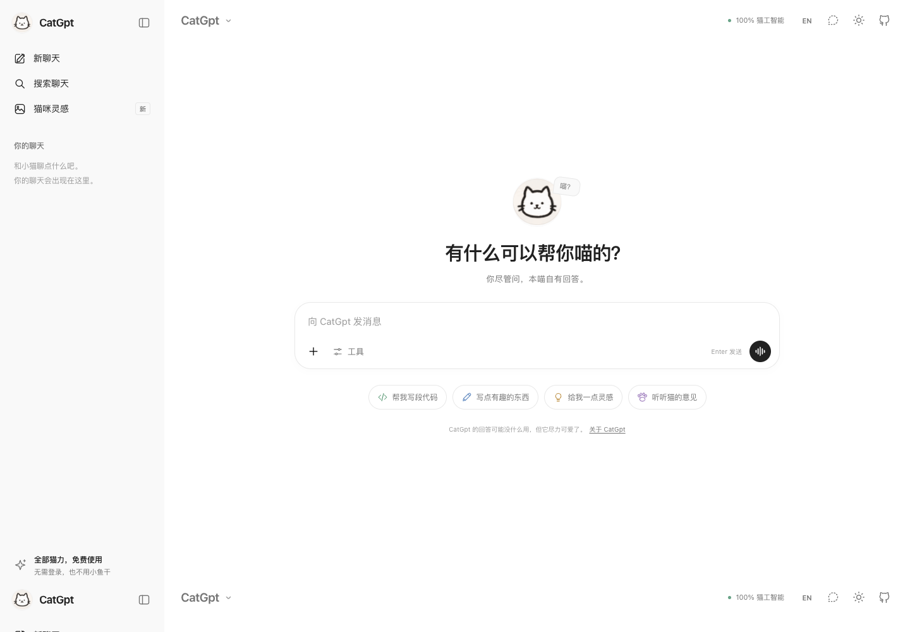
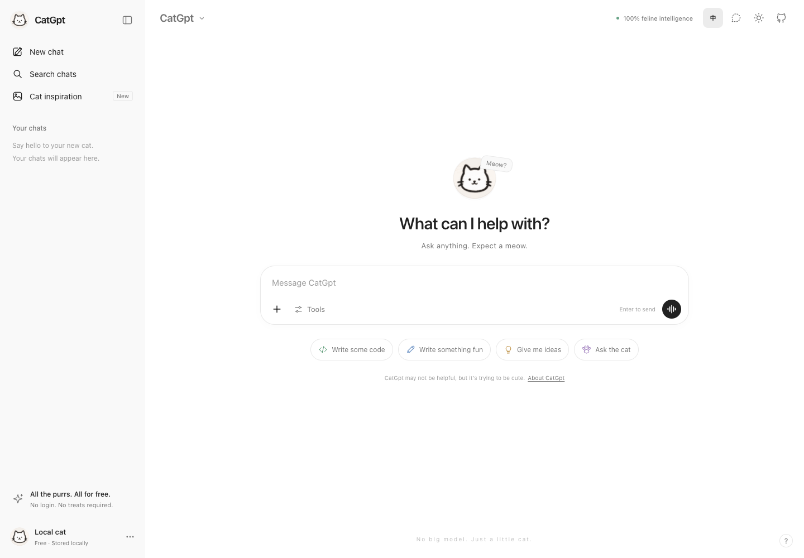

# CatGpt 🐱

一个长得很熟悉、脑子很空的猫咪聊天网站。

无论输入什么，CatGpt 只会回复：

> mewo～～🐱

[](https://vercel.com/new/clone?repository-url=https%3A%2F%2Fgithub.com%2Fzjl1985%2Fcatgpt&project-name=catgpt&repository-name=catgpt)



## 功能

- 接近 ChatGPT 的页面布局，使用眨眼猫 GIF 作为 Logo。
- 无需登录，纯前端运行，无后端、无 API Key、无模型调用。
- 支持多轮对话、新建聊天、本地聊天记录、搜索和删除。
- 支持深浅主题、跟随系统、手机端侧栏。
- 完整中英文界面，自动匹配浏览器语言；顶部可一键切换，设置中可恢复自动模式。手动选择会被记住，切换时保留聊天记录和输入草稿。
- 普通模式和「深度思喵」：思考时间不同，答案完全相同。
- 临时聊天不保存记录；普通聊天仅保存在当前浏览器的 `localStorage`。
- 复制回复、重新生成、反馈、合成猫叫、导出记录。
- Enter 发送，Shift + Enter 换行；中文输入法选词不会误发送。
- `⌘ / Ctrl + K` 搜索，`⌘ / Ctrl + Shift + O` 新建聊天。

## 本地运行

需要 Node.js 22.12+（推荐 Node.js 22 LTS）。

```sh
npm install
npm run dev
```

打开终端输出的本地地址。

```sh
npm run check   # TypeScript 检查
npm run build   # 检查并构建到 dist/
npm run preview # 预览生产构建
```

## 部署到 Vercel

点击上方 **Deploy with Vercel**，或在 Vercel 中选择 **Add New → Project**，导入 `zjl1985/catgpt`。

项目已包含 `vercel.json`，无需添加环境变量：

| 配置 | 值 |
| --- | --- |
| Framework Preset | Vite |
| Build Command | `npm run build` |
| Output Directory | `dist` |
| Install Command | `npm install` |

连接 GitHub 仓库后，推送到 `main` 即可触发 Vercel 自动部署。

## 项目结构

```text
public/cat-avatar.gif  原始眨眼猫 Logo
src/main.ts           页面和交互
src/style.css         响应式布局与主题
src/store.ts          固定回复与本地存储
src/i18n.ts           中英文文案与语言偏好
src/icons.ts          SVG 图标
vercel.json           静态部署配置
```

技术栈：Vite + TypeScript + 原生 CSS，没有前端运行时依赖。聊天内容按纯文本显示，不执行用户输入的 HTML。

这是一个非官方趣味仿作，与 OpenAI 或 ChatGPT 无关联。

## English

CatGpt is a frontend-only ChatGPT parody with a blinking cat logo. No account, backend, API key, or model calls are needed. Every response is exactly `mewo～～🐱`.



The entire interface is available in English and Simplified Chinese. It follows your browser language automatically. Use the **中 / EN** button at the top to switch, or choose **Automatic** in Settings → Language. Your choice is remembered without clearing your chats or message draft.

Run `npm install` and `npm run dev` locally. Deploy to Vercel using the button above, or import `zjl1985/catgpt`; the included configuration builds with `npm run build` and serves `dist/`. No environment variables are required.
